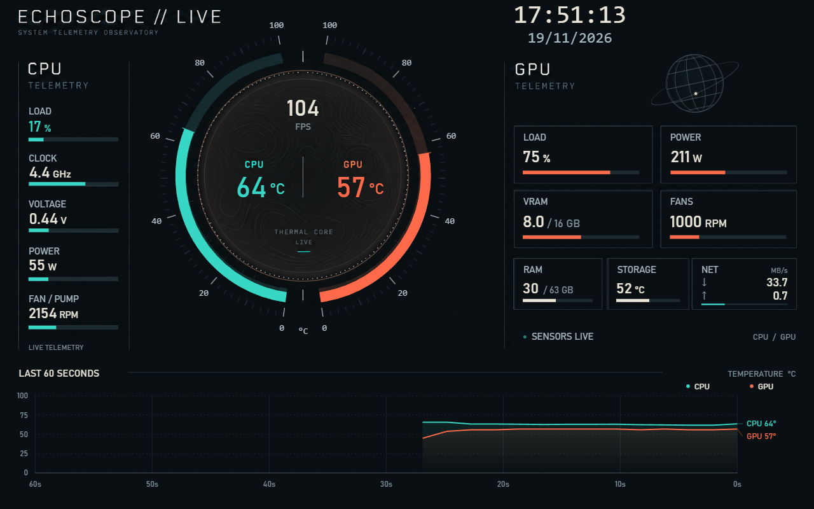

# ECHOSCOPE — тема для CLU VIEW

Тема сенсорной панели для [CLU VIEW](https://mr-clu.com/cluview): камера температур CPU и GPU с «дыханием» от нагрузки,
вращающаяся планета, показания CPU/GPU/RAM/накопителя/сети, FPS, часы и график температур за 60 секунд.



- Проверено на **CLU VIEW 2.0.6**, Windows.
- Панель с соотношением сторон **16:10** (например 1280×800 или 1024×640).
- Собрана только из штатных виджетов CLU VIEW: программу менять не нужно,
  работает и в новом (native), и в старом (webview) режиме отрисовки панели.

## Установка

1. Скачайте файл [`ECHOSCOPE.json`](ECHOSCOPE.json) (кнопка **Download raw file** на странице файла).
2. В CLU VIEW откройте **Profile Manager** → **IMPORT…** и выберите `ECHOSCOPE.json`.
3. Сделайте профиль **ECHOSCOPE** активным на экране панели.

## Настройка после импорта

Большинство показаний работают сразу — они берутся из стандартных датчиков CLU VIEW:
нагрузка, температуры, мощность CPU и GPU, вентилятор/помпа CPU, видеопамять, RAM, температура накопителя,
сеть, FPS и часы.

Три виджета нужно привязать к своим датчикам в редакторе CLU VIEW (выделить виджет → свойства → **Monitor**):

| Виджет | Что выбрать | До выбора |
|---|---|---|
| **CLOCK** (CPU) | частоту процессора, например `Cores (Average)` | `N/A` |
| **VOLTAGE** (CPU) | по умолчанию стандартный `cpu_voltage`; можно выбрать `Core VID` своего процессора | показывает `cpu_voltage` |
| **FANS** (GPU) | вентилятор видеокарты, например `GPU Fan 1` | `N/A` |

Подпись внизу справа и объём видеопамяти задаются в поле **Text** большого основного виджета
в формате `подпись|объём VRAM в ГБ`, например:

```
RTX 4070  /  RYZEN 7|12
```

По умолчанию стоит `CPU  /  GPU|16`.

## Что умеет

- Две дуги температур CPU и GPU со шкалой 0–100 °C.
- «Дыхание» камеры: частота растёт с нагрузкой CPU, яркость и цвет — с нагрузкой и температурой
  (при высокой нагрузке свечение уходит из бирюзового в оранжевый).
- Планета с двумя спутниками: орбита ускоряется от нагрузки GPU.
- График температур CPU и GPU за последние 60 секунд с подписями текущих значений.
- Предупреждение **TRAFFIC DROP**, если после устойчивой загрузки от 1 MB/s скорость сети резко падает.
- Шрифты Bahnschrift и Consolas — стандартные шрифты Windows.

## Известные ограничения

- График считает, что история датчиков CLU VIEW покрывает около 60 секунд
  (так при настройках по умолчанию; при другой частоте опроса шкала времени будет неточной).
- В режиме native текст немного мягче, чем в режиме webview.

---

## English

**ECHOSCOPE** is a sensor-panel theme for [CLU VIEW](https://mr-clu.com/cluview) (tested on 2.0.6, Windows, 16:10 panel).
It is built only from standard CLU VIEW widgets, so it needs no modified files and works with both panel renderers.

**Install:** download [`ECHOSCOPE.json`](ECHOSCOPE.json) → CLU VIEW **Profile Manager** → **IMPORT…** → make **ECHOSCOPE** the active profile.

**After import:** pick your own sensors (**Monitor** property) for the **CLOCK** (CPU clock) and GPU **FANS** widgets — they show `N/A` until then;
optionally switch **VOLTAGE** to your CPU's `Core VID`. Set the hardware label and VRAM size in the main widget's **Text** field as
`label|VRAM GB`, e.g. `RTX 4070  /  RYZEN 7|12`.
